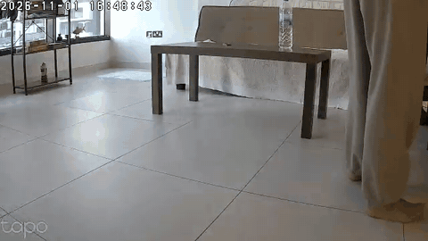

# pet-tracker

A home service that watches a dog through a TP-Link Tapo C200/C210/C211
pan/tilt camera. It follows him with the camera, logs what he does, and sends a Telegram alert with a clip
when he barks. It runs on a PC first (dev container), then always-on on a Raspberry Pi 5. Everything runs
locally on the CPU; nothing goes to a cloud service except your own Telegram messages.



**What it does**

- **Finds and follows him:** a YOLO11n detector spots him. A visual tracker keeps hold of him where the
  detector alone would lose him (far away, lying down, seen from behind), and the camera pans and tilts to keep him centred.
- **Searches when he's gone:** if he leaves the picture, the camera sweeps left and right, starting on the
  side where he walked off.
- **Activity log:** `absent / resting / active` intervals and events in SQLite, a timeline on the
  dashboard, and a daily summary with snapshots on Telegram.
- **Bark alerts:** YAMNet listens to the camera's microphone. A bark sends a Telegram message plus a clip
  (a few seconds before and after), with a cooldown so you aren't spammed.
- **Dashboard:** phone-friendly live view with his box drawn on it, the timeline, bark clips, and on/off switches.
- **Off means off:** switching off closes the camera connection completely: no video, no audio, no recording.
- **Training pictures:** keeps detector-labelled pictures of him for fine-tuning the detector on your dog later.

How it works, which neural networks it uses, and what it costs in CPU and network:
**[docs/HOW_IT_WORKS.md](docs/HOW_IT_WORKS.md)**.

---

## 1. Prepare the camera (Tapo app, 2 min)

1. Update the camera firmware (Camera → Settings → Firmware).
2. **Camera → Settings → Advanced Settings → Camera Account**: create a username and password.
   This is the local account for RTSP and ONVIF. It is *not* your TP-Link login.
   On newer firmware, also enable **Third-Party Compatibility** in the same menu (some versions: *Me → Tapo Lab*).
3. On your router, give the camera a **fixed IP** (DHCP reservation). The Tapo app shows the current IP under
   Settings → Device Info.

## 2. Create the Telegram bot (2 min, optional)

1. In Telegram, message **@BotFather** → `/newbot` → copy the token.
2. Send any message to your new bot, then open
   `https://api.telegram.org/bot<TOKEN>/getUpdates` and copy `"chat":{"id": …}`.

The bot only obeys that chat ID. Messages from anyone else are ignored.

## 3. Open the dev container on the PC

Requirements: Docker, plus either VS Code (Dev Containers extension) or the devcontainer CLI.

- **VS Code:** open the folder → *Reopen in Container*.
- **CLI:**
  ```bash
  npm install -g @devcontainers/cli
  devcontainer up   --workspace-folder .
  devcontainer exec --workspace-folder . bash
  ```

The first build takes 5–10 min because it downloads the models and exports YOLO to ONNX
(`scripts/setup_models.sh`). A `.env` is created from `.env.example`. Fill in at least:

```
CAM_HOST=192.168.x.x
CAM_USER=...                 # the Camera Account from step 1
CAM_PASS=...
DASHBOARD_TOKEN=...          # any long random string: openssl rand -hex 24
TELEGRAM_BOT_TOKEN=...       # optional
TELEGRAM_CHAT_ID=...         # optional
DOG_NAME=...
```

If the dog looks small in the picture (a big room), use the 640 px detector. It's much better at a distance;
the cost is in [HOW_IT_WORKS.md](docs/HOW_IT_WORKS.md#compute-cost):

```bash
sed -i 's/^YOLO_IMGSZ=.*/YOLO_IMGSZ=640/' .env && rm -f models/yolo11n.onnx && bash scripts/setup_models.sh
```

Then check that the container can see and hear the camera:

```bash
bash scripts/check_camera.sh     # expect: 3/3 checks passed
```

It saves `data/snapshots/check.jpg` and `check.wav`; open them to confirm it's the right room.
If ONVIF fails, set `PTZ_BACKEND=pytapo` and `TAPO_CLOUD_PASSWORD` (your TP-Link account password).

## 4. Run it

```bash
python -m app.main
```

Open `http://<pc-ip>:8000/?token=<DASHBOARD_TOKEN>` once on your phone (same Wi-Fi). The token is saved in a
cookie and removed from the address bar, so you can then add the page to your home screen.

- **Dashboard:**
  - **Watching** turns everything on or off.
  - **Follow with pan/tilt** turns camera movement on or off.
  - The box is orange for a plain detection, green while the app is locked on to him.
- **Telegram:** `/on` `/off` `/status` `/snap` `/clip` `/summary` `/help`. You get a message and then a clip for
  each bark, at most one alert per `BARK_ALERT_COOLDOWN_S` (barks in between are counted in the next alert),
  and a daily summary at `DAILY_SUMMARY_TIME`.
- **HTTP API** (token in an `X-Token` header), for scripts:
  ```bash
  curl -H "X-Token: $DASHBOARD_TOKEN" http://<pc-ip>:8000/api/state
  curl -X POST -H "X-Token: $DASHBOARD_TOKEN" http://<pc-ip>:8000/api/enabled                      # toggle
  curl -X POST -H "X-Token: $DASHBOARD_TOKEN" -d '{"enabled": false}' http://<pc-ip>:8000/api/enabled
  ```

All settings are in `.env`, explained line by line in [.env.example](.env.example).

**Your data stays in `data/`** (gitignored):
- `pet-tracker.db`: the SQLite activity log and events.
- `clips/`: bark clips.
- `snapshots/`: daily folders used by the summary, plus `training/` (pictures of your dog with labels).
- `samples/`: your recordings.

Clips and daily snapshot folders are deleted after 30 days; `training/` is kept.

## 5. Test and tune offline

```bash
pip install -r requirements-dev.txt
pytest                                          # no camera needed
bash scripts/record_sample.sh 3 living-room     # stop the app first: the Tapo allows few RTSP sessions
python scripts/analyze.py data/samples/living-room-*.mkv
python scripts/render_demo.py data/samples/living-room-*.mkv out.mp4   # replay with the tracking overlay
```

- `analyze.py` prints, for each second, whether he was seen and the bark score. Use it to tune `DOG_CONF_THRESHOLD`
  and `BARK_THRESHOLD`.
- `render_demo.py` writes the recording with the dashboard's overlay (`.mp4`, or `.gif` for docs).
- To run the whole app on a recording, set `CAM_SOURCE=data/samples/<file>` (it loops) and `PTZ_BACKEND=none`.

**Zones (optional):** `ZONES=bed:0.05,0.55,0.4,0.95;bowl:0.7,0.7,0.9,0.95` defines rectangles as fractions of
the frame (x1,y1,x2,y2). Zone events are only logged while the camera is at its home position, so set
`PTZ_HOME_PRESET` (a preset saved in the Tapo app) if following is on.

## 6. Run it always-on (PC)

```bash
docker compose up -d --build
docker compose logs -f
```

This uses the same image as the dev container, with `restart: unless-stopped`, so it comes back after reboots.
Code, models and `data/` are mounted from this folder. Stop the dev-container instance first, because both
need port 8000 and an RTSP session.

## 7. Move to the Raspberry Pi 5

Nothing in the code changes.

1. Flash **Raspberry Pi OS Lite (64-bit)**. A Pi 5 with 4–8 GB RAM and the active cooler is recommended.
2. Install Docker:
   ```bash
   curl -fsSL https://get.docker.com | sh
   sudo usermod -aG docker $USER && newgrp docker
   ```
3. `git clone` the project, copy your `.env` over, and copy `models/` from the PC to skip the slow YOLO export
   (or run `bash scripts/setup_models.sh` on the Pi).
4. `docker compose up -d --build`, then watch `docker stats`. With the 640 px detector, start with
   `DETECT_FPS=3`. See [Running on a Pi 5](docs/HOW_IT_WORKS.md#running-on-a-raspberry-pi-5).

## Remote access

The dashboard is meant for your home network only. **Don't port-forward it on your router.** To check in from
outside, install [Tailscale](https://tailscale.com/download) on the PC/Pi and on your phone, then open
`http://<tailscale-name>:8000`. Telegram alerts work anywhere without this.

## Troubleshooting

| Symptom | Fix |
|---|---|
| `check_camera.sh`: RTSP/ONVIF unreachable, but the camera works in the app | Create the Camera Account / enable Third-Party Compatibility (step 1): ports 554 and 2020 stay closed until then |
| `401 Unauthorized` on RTSP | Use the **Camera Account** credentials, not your TP-Link login |
| RTSP times out | Camera and computer must be on the same network; some mesh "guest" networks isolate devices |
| Works on the PC, not from the phone | The dashboard is on port 8000 of the host; check the host firewall |
| Stream drops when the Tapo app is open | Tapo allows only a couple of streams; close the app's live view |
| Dog not detected when far away | Use the 640 px detector (step 3) |
| Camera turns away from the dog | Some firmware inverts an axis: set `PTZ_INVERT_PAN` / `PTZ_INVERT_TILT=true` |
| Camera moves too much | `SWEEP_ON_LOST=false`, or raise `SWEEP_MIN_GAP_S`; `/api/state` shows `ptz_moves_today` |
| Too many / too few bark alerts | Tune `BARK_THRESHOLD` with `scripts/analyze.py` on a recording |

## Project layout

```
app/
  main.py          orchestrator: threads, on/off state, bark alerts, daily summary, shutdown
  config.py        .env -> Config dataclass
  stream.py        one ffmpeg per RTSP session: BGR video on stdout + 16 kHz audio on a 2nd pipe
  detector.py      YOLO11n ONNX dog detector, letterbox + numpy NMS
  bark.py          YAMNet TFLite bark detector
  tracker.py       pan/tilt controller + sweep, DogLock (detector + ViT tracker), activity state machine
  ptz.py           pan/tilt via ONVIF or pytapo, non-blocking, motor-use counters
  recorder.py      JPEG/PCM ring buffers, H.264 + AAC clip writer
  training.py      labelled pictures of the dog for later fine-tuning
  store.py         SQLite: settings, activity intervals, events
  summary.py       daily stats + text
  telegram_bot.py  long-polling bot (requests only)
  web.py           FastAPI dashboard + API (templates/, static/)
scripts/
  setup_models.sh  downloads YAMNet + ViT tracker, exports YOLO11n to ONNX -> models/
  check_camera.sh  smoke test: video, audio and ONVIF reachability
  record_sample.sh records camera footage to data/samples/
  analyze.py       per-second detector + bark report for a recording
  render_demo.py   replays a recording with the tracking overlay (.mp4 / .gif)
tests/             offline tests (no camera needed)
docs/              HOW_IT_WORKS.md
docker-compose.yml always-on deployment, reuses .devcontainer/Dockerfile
```

## License

[MIT](LICENSE) for the code in this repository. The models are not included; `scripts/setup_models.sh`
fetches them under their own licenses: YOLO11 (Ultralytics, AGPL-3.0), YAMNet (Google, Apache-2.0) and
VitTrack (OpenCV model zoo, Apache-2.0). See [docs/HOW_IT_WORKS.md](docs/HOW_IT_WORKS.md#models-where-they-come-from).
