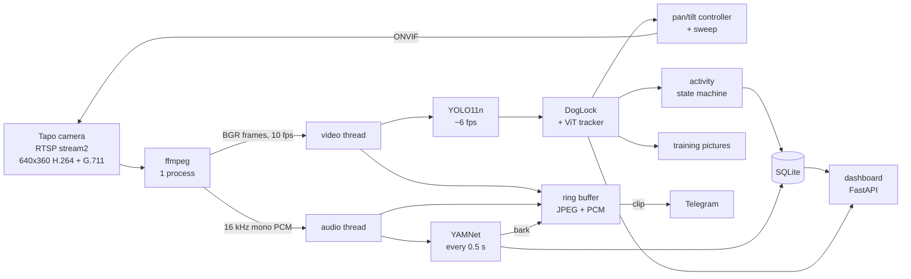

# How it works

This document covers what runs inside pet-tracker, which neural networks it uses, what it costs in CPU, memory
and network traffic, and the camera behaviour that shaped the design. The numbers were measured on a real
Tapo C200 and a desktop CPU unless marked as estimates.

- [Pipeline](#pipeline)
- [Neural networks](#neural-networks)
- [Following the dog](#following-the-dog)
- [Searching when he's gone](#searching-when-hes-gone)
- [Compute cost](#compute-cost)
- [Network traffic](#network-traffic)
- [Running on a Raspberry Pi 5](#running-on-a-raspberry-pi-5)
- [Models: where they come from](#models-where-they-come-from)
- [Training pictures](#training-pictures)

## Pipeline

One ffmpeg process holds the single RTSP connection to the camera (Tapo allows only a couple). It writes
raw video and audio to two pipes, and each pipe is read on its own thread.



Switching off kills ffmpeg, which closes the RTSP session. Nothing is decoded, heard or stored until it's
switched on again. The ring buffer keeps the last few seconds as JPEG and PCM, so a clip can include the
moments *before* a bark.

## Neural networks

| Network | Job | Input | Size | Runtime | License |
|---|---|---|---|---|---|
| **YOLO11n** (Ultralytics) | find the dog (COCO class 16 "dog") | 640×640 letterboxed frame | 2.6 M params, 6.5 GFLOPs at 640 · 10.7 MB ONNX | onnxruntime | AGPL-3.0 |
| **YAMNet** (Google) | hear barks among 521 AudioSet sounds | 0.975 s of 16 kHz audio | 3.7 M params (MobileNet v1) · 4.1 MB TFLite | ai-edge-litert | Apache-2.0 |
| **VitTrack** (OpenCV zoo, 2023-09) | keep hold of one object between frames | frame + last box | 0.7 MB ONNX | OpenCV `TrackerVit` | Apache-2.0 |

All three run on the CPU and have arm64 builds. No GPU and no PyTorch are needed at runtime.

**YOLO11n:** the app keeps only the dog class and does letterboxing and NMS in numpy. It runs at a low
threshold (0.10) and lets the lock decide which weak detections to believe (below). The 320 px export is 4×
cheaper, but in a real living room it misses the dog far too often:

| Frame (real footage) | 320 px | 640 px |
|---|---|---|
| dog standing far away | 0.14 | **0.78** |
| dog close, seen from behind | 0.25 | **0.59** |
| dog lying flat at the end of a hallway | 0.00 | 0.00 |
| 60 s clip, frames with the dog found (threshold 0.45) | n/a | 252 / 300 |

**YAMNet:** a 0.975 s window is classified every 0.5 s. The bark score is the maximum over the classes *Bark,
Dog, Bow-wow, Yip, Howl, Growling*, looked up by name in `yamnet_class_map.csv`. An event needs 2 windows in a
row above `BARK_THRESHOLD`, and one barking fit gives one event. On a test video a Labrador's barks scored
0.85–0.96 against background levels of 0.00–0.06.

**VitTrack:** a small transformer tracker. Started on a box, it finds the same object in the next frame and
reports a confidence score. On real footage it scored 0.69–0.79 (25th–50th percentile) while on the dog and
never above 0.59 once it had drifted off him. That gap sets the trust threshold of 0.6.

## Following the dog

`DogLock` (in `app/tracker.py`) combines the detector and the tracker, because each fails differently. The
detector never drifts but drops out (pose, distance, motion blur). The tracker never drops out but slowly
drifts onto furniture.

1. **Locking:** a detection at 0.6 or more starts the lock (no hand-drawn boxes).
2. **Each frame, in order:**
   - a **confident detection** (≥ `DOG_CONF_THRESHOLD`) wins, also away from the track (he ran);
   - a **weak detection** (≥ 0.2) overlapping the tracked box confirms it, and the tracker is re-centred on it;
   - otherwise the **tracker alone** carries him, but only if its score is ≥ 0.6, its box is between 0.5× and 2×
     the last confirmed size, and he was confirmed within 30 s (or the box hasn't moved, i.e. he's asleep).
3. **Release:** after 15 s without him the lock is released, and it re-locks at the next sure detection.

Each guard comes from a failure seen in testing. Without them the box drifted onto a table leg (a light, vertical
shape the detector scored 0.12–0.19), grew to cover the empty floor, and a weak match next to the track beat
a confident detection elsewhere. On the same 60 s clip the lock followed the dog in 291 of 299 frames, versus
252 for the detector alone. It agreed with confident detections 238 of 240 times.

The pan/tilt controller is a P-controller with a deadband on the box centre. It sends short ONVIF
`ContinuousMove` + `Stop` pulses and then waits **1.5 s** before aiming again. The wait matters because **the
Tapo's video runs about 1.1 s behind reality** (measured: the picture starts changing 1.1 s after a pan
starts). With a shorter wait, the controller re-aims using frames from before its own move and overshoots.
While the camera moves, the activity log ignores the dog's apparent motion.

## Searching when he's gone

After `LOST_TIMEOUT_S` without him, the camera sweeps horizontally: a pan step, a 2 s pause so the detector
sees still, up-to-date frames, repeat. It starts toward the side of the picture where he was last seen.

- **Step size:** full speed for 1 s moves the pan about 0.20 of its −1…+1 range, roughly 30°. A full pass
  takes about 30 s.
- **End stops:** after each pulse the camera's pan position is read with ONVIF `GetStatus`. If it didn't
  change, the pan is at its end stop and the sweep reverses. (Comparing pictures didn't work because of the
  1.1 s video lag; it's kept only as a fallback for the pytapo backend, which reports no position.)
- **Camera quirk:** right after hitting an end stop, the Tapo **ignores the next move**. So right after a
  reversal, a pulse that doesn't move is retried rather than taken as the other end stop.
- **Sparing the motor:** one sweep per disappearance, at most `SWEEP_MAX_S`, at least `SWEEP_MIN_GAP_S` (5 min)
  between sweeps. A sweep that found nothing isn't repeated until he's been seen again. `/api/state` reports
  `ptz_moves_today` and `ptz_motor_s_today`, and yesterday's totals are logged at midnight.

## Compute cost

Measured on an Intel i7-11850H (desktop/laptop class), 2 inference threads:

| Step | Time | How often | |
|---|---|---|---|
| YOLO11n 640 px | 49 ms (82 ms on 1 thread) | `DETECT_FPS` = 6/s | the main cost |
| YOLO11n 320 px | 13 ms (19 ms on 1 thread) | | if you switch to 320 |
| VitTrack update | 4 ms | per detection, while locked | |
| YAMNet window | 1.2 ms | 2/s | negligible |
| JPEG encode for the ring buffer | 0.5 ms | 10/s | negligible |

| Whole service (live camera, 640 px, locked on the dog) | CPU | Memory |
|---|---|---|
| Python app | **72% of one core** | 330 MB |
| ffmpeg (RTSP decode) | 3% | 80 MB |

The app was at 99% until onnxruntime's thread **spinning** was switched off. By default its idle threads
busy-wait between inferences. Measured at 6 fps: 89% vs 59% of a core for the detector alone, for about 4 ms
less latency per frame. It's now disabled in `app/detector.py`.

## Network traffic

Everything stays on your LAN except Telegram messages.

| Link | Traffic | Notes |
|---|---|---|
| Camera → pet-tracker (RTSP `stream2`, TCP) | **~0.15 Mbit/s** measured in a calm scene | H.264 640×360 + G.711 audio; more when there's motion |
| pet-tracker → camera (ONVIF, port 2020) | a few small SOAP requests per move | only while following or sweeping |
| Dashboard live view (MJPEG, 5 fps) | ~1.1 Mbit/s per open viewer (frames are ~28 KB) | only while a page is open |
| Telegram | ~0.5 MB per bark clip (measured: 450 KB for 8 s), small messages, a daily summary | outbound HTTPS only, long polling for commands |

The camera allows only a couple of RTSP sessions, so pet-tracker keeps exactly one open, and none while off.

## Running on a Raspberry Pi 5

**Not yet measured on a Pi**; these are estimates. A Pi 5 core (Cortex-A76 at 2.4 GHz) runs ONNX models
roughly 2–3× slower than the desktop core above. That puts YOLO11n 640 at about 100–150 ms with 2 threads, so:

- start with `DETECT_FPS=3` for the 640 px model (about one core in use), and check `docker stats`;
- following stays responsive at 3 fps, because the controller waits 1.5 s after each move anyway;
- if the Pi can't keep up, use the 320 px model (`YOLO_IMGSZ=320`, re-run `setup_models.sh`) and accept
  that he's missed more often when far away;
- keep `CAM_STREAM=stream2`; full HD `stream1` didn't improve detection (0.78 either way) and costs more to decode.

## Models: where they come from

`models/` is gitignored, and `scripts/setup_models.sh` (run automatically when the dev container is
created) fills it:

| File | How it's obtained |
|---|---|
| `yolo11n.onnx` | exported locally: installs `ultralytics` + CPU torch in a throwaway venv, runs `YOLO("yolo11n.pt").export(format="onnx", imgsz=YOLO_IMGSZ)`, deletes the venv |
| `yamnet.tflite`, `yamnet_class_map.csv` | downloaded from Google (MediaPipe model storage, TensorFlow models repo) |
| `vittrack.onnx` | downloaded from the OpenCV model zoo |

Why not commit them: they're binaries (about 16 MB) that bloat the git history with every change, the script
rebuilds them identically, and the YOLO11 weights are AGPL-3.0. Exporting on each machine avoids
redistributing them. To share a model of your own (for example one fine-tuned on your dog), attach it to a
GitHub Release or put it on the Hugging Face Hub, and download it from `setup_models.sh`. Git LFS also works
but has bandwidth quotas. If you publish fine-tuned YOLO weights, check the AGPL terms first.

## Training pictures

While the dog is followed, `app/training.py` saves a picture with a YOLO-format label (`0 cx cy w h`, class 0 =
your dog) at most every `TRAINING_INTERVAL_S`, and only when his box has changed since the last one, so you
get variety rather than 500 copies of a sleeping dog.

```
data/snapshots/training/images/20261101-164823-412_yolo.jpg       # confident detection
data/snapshots/training/labels/20261101-164823-412_yolo.txt
data/snapshots/training/review/...                                 # tracker-only or weak boxes: check first
```

Every box comes from the detector; none are drawn by hand, so the labels share one style. Boxes from the
tracker alone, or from a weak detection (< 0.3), go to `review/`. These are the hard cases worth learning
from, but they're the ones most likely to be wrong. The 30-day cleanup never touches `training/`.
Fine-tuning itself isn't part of this repo yet.
